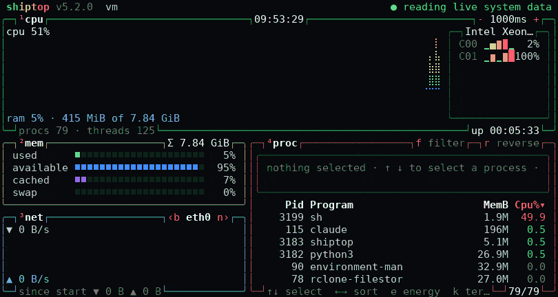

<h1 align="center">shiptop</h1>

<p align="center">
  <b>A btop-style system monitor for Windows Terminal, with a spinning pixel-3D thermal model of your laptop.</b><br>
  One 2&nbsp;MB <code>.exe</code>. No install, no admin, no dependencies.
</p>

<p align="center">
  <a href="https://github.com/manulus1/shiptop/actions/workflows/ci.yml"></a>
  <a href="https://github.com/manulus1/shiptop/releases/latest"></a>
  
  
  <a href="LICENSE"></a>
</p>

<p align="center"></p>

<p align="center"><sub>Recorded with real data on a small 2-core Linux VM under a synthetic load. On your laptop it looks busier.</sub></p>

## Why

Task Manager is fine. But your terminal deserves a cockpit: braille graphs for every core, live network
throughput, a sortable process list you drive from the keyboard, and a tiny 3D laptop that turns hot
where your CPU is working.

## Features

- **cpu**: total load graph and every logical processor with its own sparkline, uptime, process, thread and handle counts
- **mem**: used / available / cached, plus commit charge vs. commit limit
- **disks**: every local drive with used %, free space and file system
- **net**: live download / upload rates per adapter, peaks and totals since start (`b` / `n` switches adapter)
- **proc**: all processes with CPU %, GPU %, working set, threads, parent, user and path; sort, filter, terminate
- **energy view** (`e`): which processes cause the most CPU + GPU activity, i.e. what drains your battery,
  next to the real battery draw in watts and the time left
- **notebook**: a pixel-art 3D laptop rendered right in the terminal with half-block characters, coloured
  like a thermal camera by your **real** CPU and GPU load. Shows GPU load, battery draw in watts, time left,
  battery health and cycle count, and real temperatures where your laptop exposes them.
  Press `z` to zoom, arrows to rotate, `t` for visible light.

<p align="center"></p>

- **matrix mode** (`m`): digital rain made from your live data. It falls faster the busier the CPU is, each band
  of columns belongs to one logical processor (a busy core rains harder), and the glyphs are taken from the
  names of the processes running right now. A small panel shows cpu, ram, gpu, battery watts and the busiest process.

<p align="center"></p>

## Install

**Windows 10 (1809+) or 11.** Windows Terminal recommended: the classic console may show boxes instead of braille dots.

1. Download `shiptop-windows-amd64.exe` (or `-arm64` for Snapdragon laptops) from the [latest release](https://github.com/manulus1/shiptop/releases/latest).
2. Run it in Windows Terminal or PowerShell: `.\shiptop-windows-amd64.exe`

The binary is not code-signed yet, so Windows may warn about an unknown publisher: choose *More info → Run anyway*,
or run `Unblock-File .\shiptop-windows-amd64.exe` first. Checksums are in `SHA256SUMS.txt` on each release.

With Go installed: `go install github.com/manulus1/shiptop@latest`

**Linux** works too (data from `/proc`): grab `shiptop-linux-amd64` / `-arm64` from the release.

Just want to look? There is a [browser demo](https://manulus1.github.io/shiptop/) with simulated starship data, where the project started.

## Keys

| key | action |
|---|---|
| `↑` `↓` `PgUp` `PgDn` `Home` `End` | select a process (nothing is selected at start, so the busiest processes stay on screen) |
| `Esc` | deselect and jump back to the top; press again to clear the filter |
| `←` `→` | change sort column · `r` reverse |
| `e` | energy view: sort by share of CPU + GPU activity, with the battery draw on top |
| `k` / `Del` | terminate the selected process: asks `y/n`, only `y` ends it |
| `f` | filter by name, pid, path or user (`Enter`/`Esc` to finish) |
| `p` / `Space` | pause · `+` `-` update interval (250 ms to 5 s) |
| `b` `n` | previous / next network adapter |
| `t` | thermal / visible light on the notebook |
| `z` | zoom the notebook (arrows rotate it) |
| `m` | matrix mode: digital rain made from live data (`m` / `Esc` back) |
| `q` | quit |

`shiptop --once` prints a single plain-text sample, handy to compare with Task Manager.

## What is real and what is modelled

Read live from Windows, no admin rights or extra drivers needed:

- cpu, memory, disks, network and processes; process CPU % is the share of total CPU time, like Task Manager
- **GPU load** overall and per process, from the same performance counters Task Manager uses
  (busiest engine of the busiest adapter)
- **battery**: charge or discharge rate in watts, time left, capacity, health (full vs. design capacity),
  cycle count and battery temperature if the battery reports them, straight from the battery driver
- **temperatures** from ACPI thermal zones, if your laptop exposes them (shown as `zone`). These are
  motherboard or package sensors chosen by the laptop maker, not individual CPU cores.

Estimated, and marked as such:

- **energy %** in the energy view is each process' share of all current CPU % + GPU % activity. It shows who
  keeps the machine busy, it is not a per-process wattage (Windows does not expose that to normal users).
- **modelled temperatures** (marked `~`) are used only when no thermal zone is available. The model is simple:
  CPU 40 °C at idle rising linearly to 92 °C at full load, GPU 36 °C plus 40 °C × GPU load, battery
  29 °C plus up to 3 °C (4 °C more while charging). It is a plausible ballpark for a typical laptop and can
  be 10 to 30 °C off for yours.
- the **heat map** on the 3D laptop is always a model: real load and temperatures go in, but how heat spreads
  across the chassis is drawn from typical laptop layouts.

Per-core CPU temperatures on Intel and AMD need a kernel driver on Windows; shiptop deliberately does not
install one.

Terminating is guarded: shiptop always asks first, and refuses system processes such as System, csrss,
lsass or svchost, as well as itself.

## How it works

- Pure Go standard library, about 4,500 lines, no cgo and no third-party modules.
- Windows data comes from the same sources Task Manager uses: `NtQuerySystemInformation` for processes and
  per-core times, `GetPerformanceInfo`, `GlobalMemoryStatusEx`, `GetDiskFreeSpaceExW`, `GetIfEntry`.
- The screen is a cell buffer flushed as 24-bit ANSI with diffing, so only changed cells are written.
- The laptop is a tiny software rasterizer: z-buffer, perspective-correct texture lookup, flat lighting,
  a pixel-art outline pass, and a heat field sampled on a 32×22 grid.

### How it is verified

Windows APIs are easy to get subtly wrong, so:

- every struct offset, size and constant the Windows code relies on (processes, memory, performance
  counters, battery driver IOCTLs, console) is checked at compile time against the Windows SDK headers in
  [`tools/wincheck`](tools/wincheck) (run in CI with mingw-w64),
- DLLs that are not KnownDLLs (`pdh.dll`, `setupapi.dll`) are loaded by their full System32 path,
- the parsers for the process list, performance counter arrays, GPU engine names and battery structs are
  unit-tested against buffers laid out like the real ones, including Unicode names, out-of-bounds pointers
  and truncated data; the Linux battery and thermal readers are tested against fake sysfs trees,
- CI runs `shiptop --selftest` on a real **Windows** runner and on Linux: it reads every metric and fails if
  any is missing or implausible.

## Build

```
go build -o shiptop.exe .          # on Windows
GOOS=windows GOARCH=amd64 go build # cross-compile from anywhere
go test ./...
```

## Roadmap

- 64-bit network counters and friendly adapter names (`GetIfTable2`)
- disk read / write rates
- process tree view, mouse support, saved settings and themes
- winget and Scoop packages, signed binaries

Ideas and pull requests are welcome, see [CONTRIBUTING.md](CONTRIBUTING.md).

## Credits

The look is a love letter to [btop++](https://github.com/aristocratos/btop) by aristocratos. shiptop shares no
code with btop and is not affiliated with it. If you want the full btop experience on Windows, try
[btop4win](https://github.com/aristocratos/btop4win).

## License

[MIT](LICENSE)
